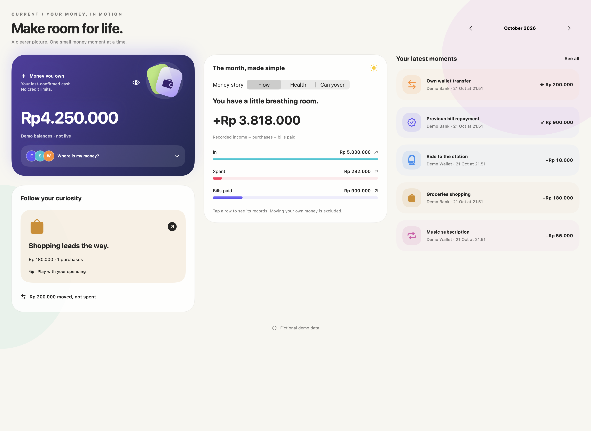

# Current

**Your money, in motion.** A SwiftUI finance tracker for iPhone, iPad, Apple Watch and native Mac, with an interactive spending explorer and Firebase sync.

[Install the companion Shortcut](https://www.icloud.com/shortcuts/d7f179ec8fc3412b949ffe5897091d70) · [Download its import file](Shortcuts/Record%20Transactions.shortcut) · [Setup guide](Shortcuts/README.md)



*Preview uses fictional data; public builds start with an empty ledger.*

## The experience

- **Home:** expandable bank/wallet balances, a tactile wallet illustration, and a monthly Flow / Health / Carryover story.
- **Spending:** interactive pie/donut chart, category selection, source filtering and editable categories.
- **Activity:** search, movement filters and review status; wide layouts keep transaction details beside the list.
- **Profile:** connect a Google identity to your Firebase account for your name, email and profile photo.
- **Adaptive layouts:** native tabs on compact screens, sidebar navigation on iPad/Mac, and two or three useful columns when space allows.
- **Apple Watch:** read-only monthly totals, last-confirmed balances and recent records supplied by the paired iPhone.
- **On-device AI categories:** Apple Intelligence categorizes supported purchases locally, with bulk review and Undo. Raw notification context stays on the capturing device and is excluded from Firebase and backups. Compatible hardware and an available Apple model are required; there is no cloud AI fallback.
- System light/dark appearance and Reduce Motion support.

## Companion Shortcut

The repository includes the original signed **Record Transactions** Shortcut and an inspectable XML copy. It contains a notification trigger selecting twelve apps and calls Current's `Record transaction from alert` App Intent with automatic source detection. See [the full guide](Shortcuts/README.md) for the app list, setup, compatibility and limitations.

**Current cannot read another app's notification history or run a notification-scanning cron job.** Capture only works when Shortcuts actually supplies transaction text to its App Intent. OS trigger support, device permissions and the message format determine what can be recorded. Review bank statements periodically; the Shortcut does not guarantee complete coverage.

## Build

Source version **1.18 (28)** adds native tabs and a separate prominent Add tab on iOS 27, with a toolbar Add button on earlier supported systems. Add uses a Current-purple original-rendered SF Symbol with a lighter dark-mode color, while the tab bar remains native.

Use Xcode with the iOS 17+, watchOS 10+ and macOS 14+ SDKs supported by the project. Current development builds use Xcode 27 beta; Liquid Glass uses iOS/macOS 26 APIs when available and falls back to material surfaces on older supported systems. Xcode resolves the official Google Sign-In Swift package automatically.

1. Clone the repository and open `Current.xcodeproj`.
2. Select **Current** for iPhone/iPad, **CurrentMac** for native Mac, or **CurrentWatch** for Watch.
3. For device deployment, choose your development team in Signing & Capabilities. Use your own bundle identifiers if needed, updating Firebase registrations and the Watch companion identifier to match.
4. Build and run. A new public build starts with **no personal transactions** and zero-valued, unconfirmed bank/wallet presets. Tap each account to set its own balance.

The build script generates an empty local Firebase configuration from the example when no real file exists. This supports an offline ledger without connecting to the publisher's Firebase project. Real configuration files are ignored by Git.

### Enable your own Firebase project

1. Create a Firebase project and register Apple apps for your iOS and native Mac bundle identifiers.
2. Enable Email/Password and/or Google in Firebase Authentication. Add the target-specific downloaded plist at `Resources/iOS/GoogleService-Info.plist` and `Resources/macOS/GoogleService-Info.plist`.
3. Create Firestore and deploy [`firestore.rules`](firestore.rules). Each signed-in user accesses only `users/{uid}/entries`.
4. The build phase derives the Google callback scheme from each target's `CLIENT_ID`. Native Mac requires its own matching OAuth configuration.
5. Sign in to the same Current account across devices. The Watch uses its paired iPhone, not a separate Firebase session.

## What the numbers mean

Purchases, income, transfers between your accounts and payments of existing debt are separate movement types. Transfers are not new spending. Monthly cash flow is income minus purchases minus bills paid. Unresolved records stay visible but are excluded from confirmed totals.

Balances preserve **last-confirmed snapshots** and show estimates separately. Estimates apply assigned, confirmed movements strictly after each account’s snapshot. Transfers require both account legs; unknown funding remains visible for review. These estimates are not live bank balances. Health labels describe recorded cash flow and are not a personalized financial assessment.

This public repository contains no imported personal ledger, private bank screenshots, Firebase production configuration or signing credentials. UI screenshots, if included, use fictional demo data. The source does not connect to bank APIs or import a mailbox directly.

## Documentation

- [Project structure](Documentation/PROJECT_STRUCTURE.md)
- [Calculations and capture limits](Documentation/CALCULATIONS.md)
- [Google Profile setup](Documentation/GOOGLE_PROFILE.md)
- [Companion Shortcut](Shortcuts/README.md)

## Checks

On a Mac with Xcode selected:

```sh
sh Scripts/checks.sh
```

These checks exercise categorization, review exclusions, transaction parsing, booking deduplication and account-identity continuity. They use fictional fixtures and do not contact Firebase.
